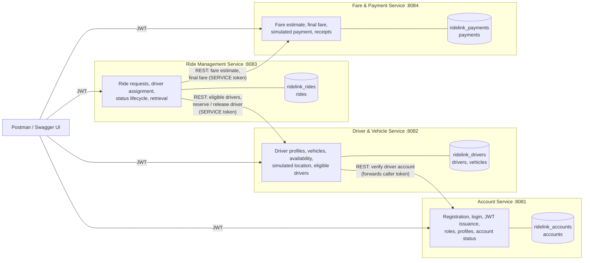

# Architecture

## Service map

Dependencies form a chain with no cycles: Ride depends on Driver and Fare, Driver depends on Account, and Fare and Account depend on nothing. Fare never calls Ride: Ride pushes everything Fare needs (ride id, passenger, driver, vehicle type, distance, duration) when the ride completes.

## Responsibilities and data ownership

| Service | Owns (only this service writes it) | Holds as foreign ids only | Exposes to other services |
|---|---|---|---|
| Account | `accounts`: email, BCrypt hash, role, status | none | `GET /api/v1/accounts/{id}` |
| Driver & Vehicle | `drivers`: account id, licence, service area, availability, location, location time; `vehicles`: plate, type, seats, active | account id | `GET /api/v1/drivers/available`, `PATCH /api/v1/drivers/{id}/availability` |
| Ride Management | `rides`: pickup, destination, status, timestamps, estimated and final fare snapshot | passenger account id, driver id, driver account id, payment id | none (clients only) |
| Fare & Payment | `payments`: fare breakdown, amount, status, method, card last 4, transaction id, receipt number | ride id, passenger id, driver id | `POST /api/v1/fares/estimate`, `POST /api/v1/fares/final` |

Rules that keep the boundaries clean:

* One MongoDB database per service. A service's connection string only points at its own database, so cross-service queries are impossible by construction. In production each database would also have separate credentials.
* Only stable identifiers cross boundaries (MongoDB ObjectId strings). No service copies another's full model; clients read only the fields they need (`AccountSummary`, `AvailableDriver`, `FareQuote`) and ignore unknown fields, so services can evolve independently.
* Values that matter for money are never taken from the client: the passenger id comes from the JWT, and estimated and final fares come from Fare & Payment.

## Why these four boundaries

Each service maps to one business capability with its own data and its own rate of change:

* **Account** changes when identity or access rules change.
* **Driver & Vehicle** changes when fleet and availability rules change, and is queried heavily during matching.
* **Ride Management** owns the core workflow and its state machine.
* **Fare & Payment** owns pricing and money, which need the strictest correctness and audit trail.

The four are of comparable size (roughly 30 to 50 unit tests each) and can be developed, tested, deployed and scaled separately. For example, matching load hits Driver and Ride, not Account.

## Microservices compared with a monolith

| Concern | Monolith (one Spring Boot app, one database) | RideLink microservices |
|---|---|---|
| Team of four working in parallel | Shared codebase, frequent merge conflicts | Each member owns one service and its pipeline |
| Data integrity | One ACID transaction across rides and payments | No distributed transaction; handled with idempotent final-fare calls, state checks and best-effort driver release |
| Failure isolation | One crash stops everything | Fare down: bookings fail fast with 503 while accounts and drivers keep working |
| Scaling | Scale everything together | Scale Driver and Ride independently at peak times |
| Latency and simplicity | In-process calls, simple to debug | Network hops, timeouts, more moving parts and four processes to run |
| Technology choice | One stack | Per-service choice possible (all use Spring Boot here for consistency) |

**Conclusion for this scenario:** the brief requires independent development, clear business boundaries and future scaling, which favour microservices. The costs (distributed data consistency, network failure handling and more operational work) are real, and are handled explicitly in the code and listed under limitations. For a small real-world start-up, a modular monolith with the same four modules would be a reasonable first step that could be split later.

## Framework choice

| Choice | Reason |
|---|---|
| Java 21, Spring Boot 4.1 | Prescribed in labs; mature ecosystem; independent executable jars |
| Spring Web MVC + Bean Validation | REST controllers with declarative input validation |
| Spring Data MongoDB | Document model fits rides and payments with embedded locations and fare breakdowns; schema can evolve without migrations |
| Spring Security + jjwt | Stateless JWT authentication, role rules with `@PreAuthorize` |
| springdoc-openapi | Swagger UI and accurate OpenAPI generated from the code |
| RestClient | Simple, synchronous HTTP client with timeouts for interservice calls |
| JUnit 5, Mockito, AssertJ, MockMvc | Fast unit tests without a database |
| GitHub Actions | CI for all four services on every push and pull request |

## Cross-cutting conventions (identical in all four services)

* Base path `/api/v1/...`, JSON only, plural resource names, sub-resources for lifecycle actions (`/rides/{id}/accept`).
* One error format everywhere: `{timestamp, status, error, message, path, fieldErrors?}`.
* Status codes: 400 invalid input, 401 missing or invalid token, 402 payment declined, 403 wrong role or not the owner, 404 not found, 409 business rule or state conflict, 502 dependency rejected the call, 503 dependency unavailable.
* Configuration only through environment variables (`.env` locally); no secrets in the repository.
* Packages `com.ridelink.<service>` with `controller`, `service`, `repository`, `model`, `dto`, `client`, `security`, `exception`, `config`.

## Known limitations and improvements

* **Shared HMAC secret.** Any service holding `JWT_SECRET` could mint tokens. Production would use asymmetric keys (RS256) where only Account Service holds the private key, plus OAuth2 client credentials for service tokens.
* **No distributed transaction.** If Driver & Vehicle is down when a ride ends, the ride still completes but the driver stays ON_TRIP until released. A transactional outbox with a message queue would guarantee eventual release.
* **Simplified matching and fares.** Straight-line distance times a road factor of 1.3, and nearest driver in the same service area. A real system would use a routing engine and live GPS.
* **No API gateway or service registry.** Clients call each service's port directly; a gateway would add one entry point, rate limiting and central token checks.
* **Single MongoDB server locally.** Separate databases give logical isolation; production would use separate clusters.
