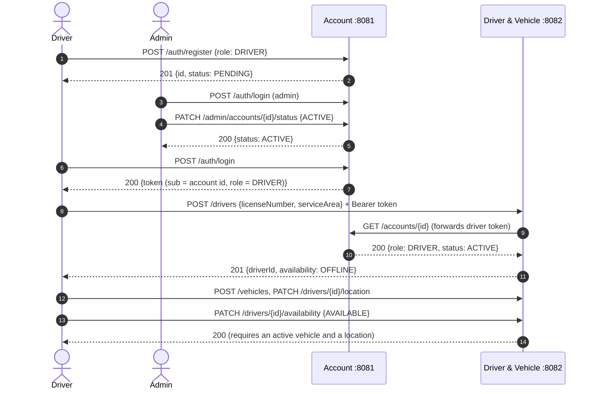
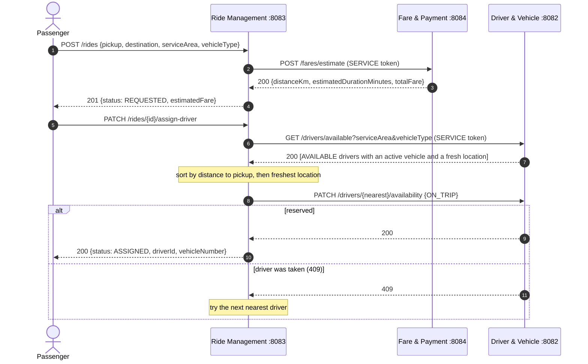
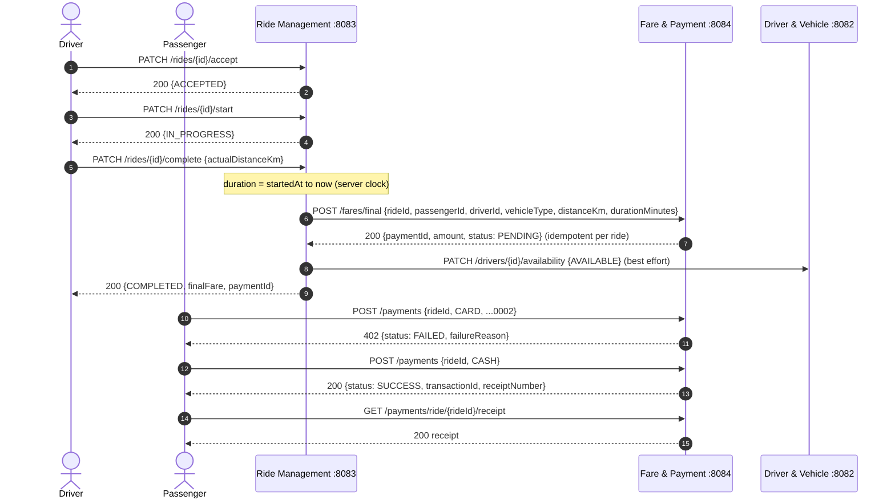
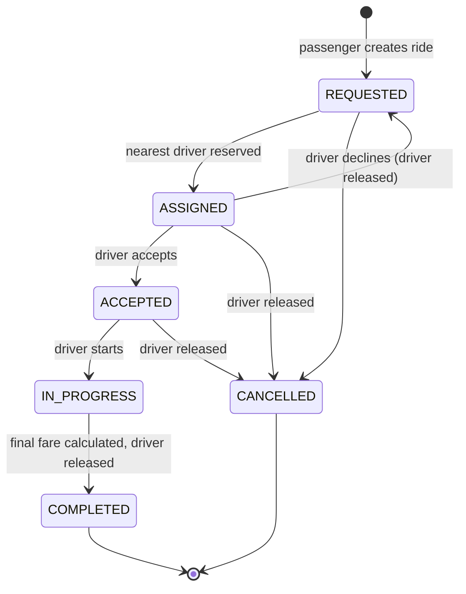

# Sequence diagrams

## 1. Driver onboarding (Driver & Vehicle calls Account)

If the account is still PENDING, step 10 returns 409. If Account Service is down, the driver gets 503 and no profile is created.

## 2. Ride request and assignment (Ride calls Fare, then Driver)

With an empty list, step 7 ends with 409 "No available driver" and the ride stays REQUESTED, so the passenger can retry or cancel.

## 3. Lifecycle, completion and payment (Ride calls Fare and Driver)

If Fare & Payment is down at step 5, the driver gets 503 and the ride stays IN_PROGRESS, so no ride is ever completed without a fare. Because `/fares/final` is idempotent, retrying never creates a second charge.

## Ride state machine

Any other transition returns 409 with the current and requested status. An in-progress trip cannot be cancelled: it must be completed so it can be charged.
